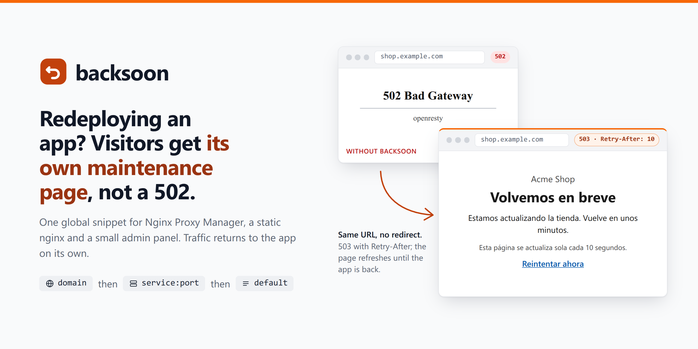

**English** | [Español](README.es.md)

# backsoon



A friendly maintenance page for apps behind Nginx Proxy Manager (NPM). When an upstream is down, NPM hands the request to `backsoon`, a static nginx that answers `503` with the right page for that domain or destination. Design and requirements live in [PRD.md](PRD.md).

> **Status: in development.** Static `backsoon` and the NPM global snippet are verified (local end-to-end acceptance and independent functional verification; the snippet was left without native review by the owner after a tooling failure, which is not native approval). The `backsoon-admin` panel is implemented and passed its end-to-end suite (388 checks through real NPM) and an independent verification. No production deployment has been performed. The installation guide ([docs/install.md](docs/install.md)) was rehearsed on an isolated host and network, without TLS or the real Portainer and NPM interfaces. The CI workflow runs lint and tests on every push; the end-to-end suites run on demand.

| Piece | State |
|-------|-------|
| `backsoon` static nginx service (`nginx/`, `templates/`, `docker-compose.yml`) | implemented |
| Local NPM test harness (`compose.test.yml`, [docs/npm-harness.md](docs/npm-harness.md)) | separate unit, see its doc |
| `npm/server_proxy.conf` and `make e2e` (`test/e2e.sh`) | local acceptance and independent functional checks passed; owner-authorized native-review omission |
| `backsoon-admin` panel (`admin/`, `make e2e-admin`) | implemented; end-to-end and independent verification passed |
| CI ([.github/workflows/ci.yml](.github/workflows/ci.yml)) | lint and test on every push and pull request; `make e2e` on manual dispatch |
| Installation guide ([docs/install.md](docs/install.md)) | written; clean-host rehearsal passed (CA-23), production not yet |

## Install

The common case is a Portainer Git stack next to your Nginx Proxy Manager (NPM), with the NPM fallback installed automatically. Follow the **[quick path in the installation guide](docs/install.md#quick-path-portainer-git-stack)**. In short:

1. Find the Docker network NPM shares, its address range and NPM's data folder on the host.
2. Generate the password hash and the session secret, and set the variables ([Configuration](#configuration), [Admin panel](#admin-panel)).
3. Deploy the stack in Portainer: it builds its own images from this repository.
4. Create the panel's NPM proxy host (`backsoon-admin:8080`, SSL, Force SSL); saving it activates the fallback.
5. Stop an application to see its maintenance page.

The [reference part of the guide](docs/install.md#reference) covers plain `docker compose`, the manual snippet install, [verification](docs/install.md#verification), [what happens when `backsoon` or the panel is stopped](docs/install.md#when-backsoon-or-the-panel-is-stopped), [rollback](docs/install.md#rollback) and [what to do after updating NPM](docs/install.md#after-updating-npm).

## Quick path: try the service on its own

Needs Docker. Pick any free loopback port; the volume name below is throwaway.

```sh
docker build -t backsoon:try -f nginx/Dockerfile .
docker volume create backsoon_try_pages
docker run --rm -v backsoon_try_pages:/pages --entrypoint sh backsoon:try /docker-entrypoint.d/45-backsoon-seed.sh
docker run -d --name backsoon-try -v backsoon_try_pages:/pages:ro -p 127.0.0.1:8088:80 backsoon:try
curl -si http://127.0.0.1:8088/any/path      # 503 + Retry-After + Cache-Control: no-store + X-Backsoon: 1 + CSP + nosniff
curl -si -H 'Accept: application/json' http://127.0.0.1:8088/   # 503 + {"status":"maintenance","retry_after":10}
```

Clean up with `docker rm -f backsoon-try && docker volume rm backsoon_try_pages`.

Production uses the same pieces through `docker-compose.yml`: a one-shot `backsoon-init` seeds the volume, then `backsoon` serves it read-only on the external `proxy` network (or `BACKSOON_PROXY_NETWORK`), with no published ports (`docker network create proxy` first, and attach NPM to it).

## How a page is chosen

| Order | Source | File in the `backsoon_pages` volume |
|-------|--------|--------------------------------------|
| 1 | `Host` header (lowercase, no port) | `/pages/host/<host>.html` |
| 2 | `X-Backsoon-Target: service:port` (sent by NPM) | `/pages/target/<service>_<port>.html` |
| 3 | default | `/pages/default.html` |
| 4 | nothing exists | `503` with an empty body (never `404`) |

Invalid hosts or targets never reach the filesystem: they fall back to the default page (nginx itself answers `400` to hosts containing `/`). Pages are read on every request, so adding, changing or removing a file takes effect immediately.

## Configuration

Copy [`env.example`](env.example) to `.env` and edit the private copy. In Portainer, enter the values under **Environment variables** or use **Load variables from .env file** to upload it. Never commit real credentials: `.env` and `.env.*` files are ignored; the public example contains no secrets.

The example lists every variable the stack reads. Its secrets are deliberately blank: fill them in your private copy (see [Admin panel](#admin-panel)).

| Variable | Default | Meaning |
|----------|---------|---------|
| `BACKSOON_REFRESH` | `10` | Seconds used for `Retry-After`, the JSON `retry_after` and the page's `<meta http-equiv="refresh">`. Integer 1-99999; anything else stops the container at start. Shared with the panel. |
| `BACKSOON_ADMIN_USER` | none | User name of the panel's owner. Required by the panel. Other users are added in the panel itself (see [Users and roles](#users-and-roles)). |
| `BACKSOON_ADMIN_PASSWORD_HASH` | none | bcrypt hash of the owner's password. Preferred; wins if both password variables are set. |
| `BACKSOON_ADMIN_PASSWORD` | none | Plaintext alternative (at most 72 bytes). Accepted, with a warning in the panel log. |
| `BACKSOON_SESSION_SECRET` | none | Random secret of at least 32 bytes that signs the 12-hour session cookies. Required by the panel. Signing out revokes the session at once, but the panel keeps that list in memory: after a panel restart, a copy of a signed-out cookie works again until its 12 hours end. Change this secret to end every session. |
| `BACKSOON_ADMIN_HOST_BIND` | `127.0.0.1` | Host address the panel's port is published on. Use `0.0.0.0` only if NPM or someone else must reach it through the host's IP; `127.0.0.1` keeps it local (SSH tunnel). |
| `BACKSOON_ADMIN_HOST_PORT` | `8181` | Host port published for the panel (container port 8080). |
| `BACKSOON_NPM_CUSTOM_DIR` | none | Host path of NPM's `/data/nginx/custom` directory, for example `/docker/nginx-proxy-manager/data/nginx/custom`. When set, the one-shot `backsoon-npm-snippet` service installs `server_proxy.conf` there on every deploy (unchanged files are left alone; a `server_proxy.conf` that is not backsoon's is never overwritten). NPM applies it at its next reload: save any proxy host or restart NPM. |
| `BACKSOON_NPM_INTERCEPT_503` | `true` | `false` installs the variant that leaves application `503` responses alone (intercepts only `502` and `504`). |
| `BACKSOON_NPM_RESTORE` | `false` | `true` restores NPM's default configuration: the next deploy removes backsoon's `server_proxy.conf` from `BACKSOON_NPM_CUSTOM_DIR` instead of installing it (never a file that is not backsoon's); reload NPM, then remove the stack. See [Rollback](docs/install.md#rollback). |
| `BACKSOON_PROXY_NETWORK` | `proxy` | Name of the existing external Docker network shared with NPM, for example an NPM network such as `npm-nw`. |
| `BACKSOON_TRUSTED_PROXIES` | none | IP addresses or CIDR ranges, separated by commas or spaces, allowed to set the `X-Real-IP` header that keys the login rate limit; set it to the `proxy` network range, for example `172.18.0.0/16`. A peer outside the list is limited by its own address. Unset, the panel believes `X-Real-IP` from any peer. An invalid entry stops the panel at start. |

Without a user, a password or hash, and a secret the panel exits at start with a message naming the missing variable; it never runs without login. `backsoon` does not depend on the panel and keeps serving pages if the panel is stopped or misconfigured.

The provisional `default.html` is rendered from `templates/maintenance.html` by `backsoon-init`. If `default.html` already exists, seeding changes nothing, so redeploys keep your pages (and an old refresh value inside an existing page). Concurrent initializers render into exclusive temporary files on that volume and publish with a non-overwriting hard link; a losing initializer cannot modify the published page.

## Admin panel

`backsoon-admin` manages the pages: create one from the template or upload a self-contained `.html` (UTF-8, at most 512 KB), assign it to domains and `service:port` destinations, preview it in a sandbox, replace or delete it. Every change is published atomically to the `backsoon_pages` volume and is served on the next request, with no restart. The panel answers the question "which page does this destination show?" in the same order `backsoon` uses.

The panel is available in English and Spanish. It picks the language from the `backsoon_lang` cookie if present, otherwise from the browser's `Accept-Language` header (for example `es-ES` selects Spanish), otherwise English. The **ES / EN** switch in the navbar, and on the sign-in page, changes it without JavaScript and remembers the choice in the `backsoon_lang` cookie for about a year (`HttpOnly`, `Secure`, `SameSite=Strict`). Only the panel is translated: its log stays in English, and the maintenance page that visitors see keeps the language you give it.

1. **Create the password hash.** Use bcrypt cost 12 (the `htpasswd` default, 5, is too weak for an internet-facing login):

   ```sh
   docker run --rm httpd:2.4-alpine htpasswd -nbBC 12 admin 'your-password' | cut -d: -f2
   ```

   The output starts with `$2y$12$` and is 60 characters long. Prefix the command with a space or clear your shell history afterwards, since it contains the password.

2. **Set the variables** in Portainer (Environment variables) or in your private `.env`. A bcrypt hash contains `$`, which Docker Compose treats as the start of a variable when it reads an env file. Checked with Docker Compose 5.6.0:

   | How the hash is given | Result |
   |-----------------------|--------|
   | `.env`: `BACKSOON_ADMIN_PASSWORD_HASH='$2y$12$…'` (single quotes) | intact |
   | `.env`: every `$` written as `$$` | intact |
   | process environment (`export …` before `docker compose up`) | intact |
   | `.env` without quotes, or with double quotes | **truncated** to `$2y$12` |

   A truncated hash is not a silent login failure: the panel refuses to start with `BACKSOON_ADMIN_PASSWORD_HASH is not a valid bcrypt hash`. If you see that message after entering the hash in Portainer, enter it again with every `$` written as `$$`.

3. **Generate the session secret**, for example `openssl rand -hex 32`.

4. **Publish the panel through NPM** with a proxy host such as `backsoon.example.com` → `backsoon-admin:8080`, with SSL. The session cookie is `Secure`, so the panel signs in only over HTTPS or on `http://localhost`: its published host port (`127.0.0.1:8181` by default, see `BACKSOON_ADMIN_HOST_BIND`) is meant for an SSH tunnel, not plain `http://` access. Requests to that port reach the panel from the network's gateway address, which the recommended `BACKSOON_TRUSTED_PROXIES` range includes, so whoever can reach the port can also set `X-Real-IP`: keep it on `127.0.0.1`. The panel trusts the `X-Real-IP` header that NPM sets for the login rate limit (5 failed attempts per IP every 15 minutes). Without `BACKSOON_TRUSTED_PROXIES` the panel accepts that header from any peer, so any container attached to the `proxy` network could forge it and bypass the limit (bcrypt remains the brake). Set `BACKSOON_TRUSTED_PROXIES` to the `proxy` network range, which `docker network inspect proxy --format '{{range .IPAM.Config}}{{.Subnet}} {{end}}'` prints, so only that network can set it; the panel logs the trusted ranges at start. NPM's own address can change between restarts, so prefer the network range to a single address. Keep only trusted containers on that network either way. Behind a CDN, all visitors may share one address, so a few failed logins can lock out the administrator for 15 minutes. An NPM Access List or a LAN/VPN-only host adds another layer.

The panel stores its metadata in the `backsoon_meta` volume (`sites.json` plus the original HTML of each page, and `users.json` once you add users) and republishes every page from it at start, which repairs an inconsistent `backsoon_pages`. It runs as uid 65532 on a read-only root filesystem with all capabilities dropped; `backsoon-init` hands the pages volume to that user on every deploy. The panel's visual system is described in [DESIGN.md](DESIGN.md).

### Users and roles

The panel has two roles.

- **Owner.** The user from `BACKSOON_ADMIN_USER`, with the password from `BACKSOON_ADMIN_PASSWORD_HASH` or `BACKSOON_ADMIN_PASSWORD`. It manages users and pages. It cannot be deleted, renamed or have its password changed from the panel: that password lives in the stack variables, and changing it there (and redeploying) ends the owner's sessions.
- **Editor.** Every user added in the panel. Editors manage pages exactly like the owner and change their own password. They never see user management: the navbar has no **Users** entry, and the server answers `403` to every request for it, whatever the request carries.

**Managing users** (owner only, **Users** in the navbar):

- **Add a user** with a user name and an initial password typed twice. Names are 1 to 64 characters from `a-z 0-9 . _ -`, compared without regard to case and stored in lowercase; each is unique and never the owner's name. Passwords have at least 10 characters and at most 72 bytes (the bcrypt limit). You choose the initial password and pass it on to the user yourself.
- **Set a new password** for a user, or **delete** a user. Each asks for a confirmation first, and each ends every session of that user immediately, also across panel restarts.
- The list shows each user's name, when it was created and when its password last changed.

**Own password.** Every editor opens **My password** in the navbar, gives the current password and the new one twice, and changes it. Their other sessions end; the browser that made the change stays signed in. The check of the current password is rate limited (5 wrong attempts per 15 minutes per user). The owner's page explains where the owner's password is set instead of offering a form.

**Storage and logs.** Users are stored in `users.json` in the `backsoon_meta` volume, written atomically with mode `0600`, as bcrypt cost 12 hashes only. A corrupt or invalid file stops the panel at start with a message that names it; fix the file, or remove it to delete every added user. Back it up with `backsoon_meta`. Sign-in uses the same rate limit and the same single error message for an unknown user and a wrong password. The log names the user at sign-in, who added or deleted a user or set a password (and for whom), own password changes, and the user behind every page change; it never contains a password, a hash or a session cookie.

**Upgrading from a version without users.** Session cookies now carry the user, so sessions issued before the upgrade stop working once: everyone, in practice the owner, signs in again after the first start of the new version. If you later set `BACKSOON_ADMIN_USER` to the name of an added user, the owner wins and that added user can no longer sign in; delete or rename them first.

## Commands

| Command | What it does |
|---------|--------------|
| `make lint` | `docker compose config`, `nginx -t` on the rendered config, pinned-image and self-contained-page checks, shell syntax, panel wiring, `gofmt` and `go vet` for `admin/`. |
| `make test` | Builds the image and runs `test/unit.sh` (curl tests against throwaway containers on loopback ephemeral ports, `bs-unit-*` names, removed on exit, including concurrent seeding), then the panel's Go tests. |
| `sh test/seed-race.sh` | Focused concurrent-seeding regression with two real init entrypoints and a read-only HTTP reader; checks publication, no overwrite and cleanup. |
| `make e2e-up` / `make e2e-down` | Start / remove the NPM harness. See [docs/npm-harness.md](docs/npm-harness.md). |
| `make e2e` | Both disposable real-NPM suites, one after the other: `make e2e-npm` (healthy routing, host/target/default fallback, POST/HEAD/JSON, 502/503/504, absent backend/restart/recovery, rollback, legitimate-503 variant, latency gate) and `make e2e-admin` (the panel through NPM: login, rate limit, CSRF, users and roles, uploads, destinations, preview sandbox, publication visible on the next request). Never run them in parallel: they share the loopback ports. |

`make lint` and `make test` need Go 1.26 or newer in addition to Docker.

## Details

| Topic | Decision |
|-------|----------|
| Image | `nginx:1.30.5-alpine-slim`, pinned by digest in `nginx/Dockerfile`. Its entrypoint ships `envsubst`, so the plain `nginx:alpine` fallback is not needed. |
| Config rendering | `nginx/default.conf.template` is rendered by the official entrypoint. `NGINX_ENVSUBST_FILTER` limits substitution to `${BACKSOON_REFRESH}`, so nginx's own `${...}` captures survive. |
| Runtime | `worker_processes 1` in `nginx/nginx.conf`; nginx is the only process. |
| Logs | `host target status file` per request, no client address. Pages with no file log the empty-response helper URI. |
| Security headers | Every maintenance response (HTML, JSON, empty) also carries `Content-Security-Policy: default-src 'none'; style-src 'unsafe-inline'; img-src data:; form-action 'none'; frame-ancestors 'none'; base-uri 'none'` and `X-Content-Type-Options: nosniff`. Pages are self-contained, so visitors' browsers never run a script, load an external resource, embed a frame or submit a form from a maintenance page, whatever the uploaded HTML contains; inline CSS, inline SVG and `data:` images keep working. |
| Build context | Repository root, so the image reuses `templates/maintenance.html`. |

## NPM global configuration

`npm/server_proxy.conf` is the only NPM configuration file needed. NPM must share the external `proxy` network with `backsoon`. Each proxy host keeps its normal upstream and **empty advanced configuration**.

After choosing the interception policy, install the file in your NPM container and validate before reloading:

```sh
docker cp npm/server_proxy.conf <npm>:/data/nginx/custom/server_proxy.conf
docker exec <npm> nginx -t && docker exec <npm> nginx -s reload
```

The named fallback passes the original host, the `Accept` header and NPM's `$server:$port` to `backsoon`. Variable `proxy_pass` defers DNS resolution, and interception is disabled inside the fallback so the 503 from `backsoon` is not re-intercepted. The internal request to `backsoon` always targets the fixed URI `/` (the trailing `/` in the variable URL), whatever the application URI was, so an application path such as `/healthz` or `/__backsoon` can never reach `backsoon`'s private locations; the browser URL does not change and nothing is redirected. Only `backsoon` adds maintenance headers.

### When `backsoon` is unavailable

Bounded degradation: only the fallback gets short timeouts (2 s resolving, 2 s connecting, 5 s of inactivity per send/read, one attempt); your applications keep NPM's own timeouts. If `backsoon` is stopped, missing or unreachable, the fallback fails within that bound and NPM answers with its native generic `502` (no maintenance headers or body).

nginx normally stops after the first `error_page` jump (`recursive_error_pages off`), so a failed fallback would end as a slow `504` or a hang on a stale cached address. The file therefore enables `recursive_error_pages` and fixes the chain to `server → @backsoon → @backsoon_unavailable`. `@backsoon` declares its own `error_page 502 504` list pointing to `@backsoon_unavailable`, which returns `502` and declares its own inert list. Each own list replaces the inherited one, so no hop can return to `@backsoon`. The one editable business list remains the only `error_page … @backsoon;` line.

NPM's request log shows a controlled HTTP `502` from an application as `upstream_status` `502 : 503` with client status `503` (observed on NPM 2.16.0 with the test fixture). A DNS-resolution failure of the application can log `-, 503` instead, so do not assume one format for every `502` cause.

### Applications with legitimate 503 responses

Edit only the single business `error_page … @backsoon;` line in the copied global file to exclude 503:

```nginx
error_page 502 504 =503 @backsoon;
```

Validate and reload NPM again (nginx applies a reload asynchronously: old workers keep serving until they exit). Your application then keeps its own 503 body and headers; 502/504 still use maintenance. Choose this policy before installing globally, since an application-generated 503 is otherwise intercepted.

### Disable safely

```sh
docker exec <npm> mv /data/nginx/custom/server_proxy.conf /data/nginx/custom/server_proxy.conf.disabled
docker exec <npm> nginx -t && docker exec <npm> nginx -s reload
```

No proxy host or stored page is changed. Copy the repository file back and reload to enable it again. With the automatic install, use `BACKSOON_NPM_RESTORE=true` instead (see [Rollback](docs/install.md#rollback)); otherwise the next deploy installs the file again.

## Verification and remaining scope

```sh
make lint
make test
BACKSOON_TEST_HTTP_PORT=18080 BACKSOON_TEST_ADMIN_PORT=18181 make e2e
```

Use free loopback ports. `make e2e` requires a fresh `backsoon-*` project, seeds only test fixtures, and removes its containers/volumes on exit. It uses the same Dockerfile/config/entrypoint as production and a deterministic private upstream fixture. See [the harness guide](docs/npm-harness.md).

`make lint` wraps the NPM snippet in a syntax-only `server{}`; `make e2e` also checks actual NPM nginx syntax and dynamic recovery.

`make e2e` is one fixed procedure with no threshold or skip option. Functional checks run first; if any fails, the run exits failed and the performance step is skipped. Every reload (install, variant, rollback, absent backend) waits for the previous NPM worker generation to retire, because `nginx -T` or a first successful response does not prove all workers use the new configuration. Before the missing-backend check, a disposable proxy host points at the live test fixture on a closed port (immediate connection refusal), so the stopped `app1` is never queried while warming; an explicit reload (with the generation barrier) gives fresh workers with a cold `app1` cache. Then 150 fixed requests through that host must each return maintenance 503 with `X-Backsoon: 1` and the page, which makes every current NPM worker use and cache the `backsoon` address. Each worker must show the connection refusal (`connect() failed (111`) for that host in NPM's own error log; if a request fails, a worker is not covered or the window is exceeded, the run records curl's exit status/stderr and the NPM logs and fails before that check instead of claiming it. The single request that follows keeps the original 10 s client limit.

RNF-5 uses eight alternating blocks A/B/A/B/A/B/A/B (A: global file disabled, B: canonical file enabled), a worker-generation barrier at each switch, 20 discarded and 50 recorded healthy requests per block (200 records per mode), and the PRD's gate `median(B) ≤ median(A) × 1.05` over all records. All block medians and the aggregate are printed, all samples are kept under gitignored `.odd-checks/`, no healthy request may add a `backsoon` access-log line, and the run ends with the canonical file enabled. It is evaluated once per run, not retried until it passes. The recorded local acceptance passed 111 checks; a separate isolated functional-only verification passed 101 checks without repeating the benchmark. All eight blocks gave aggregate medians of 484 µs (A) and 474.5 µs (B), a −1.9628% difference, satisfying the 5% gate for that run. This is not evidence of a universal speedup. The earlier serial run's +5.47% failure is retained, not hidden.

Real production redeploy checks remain deferred to U8; the installation guide's rehearsal limits are listed in [what has been verified](docs/install.md#what-has-been-verified). Static-page browser checks cover 320/1280 px in light/dark mode; the manual browser recovery timing in CA-2 has not been verified. TLS and physical-device testing are not part of the local NPM harness.
